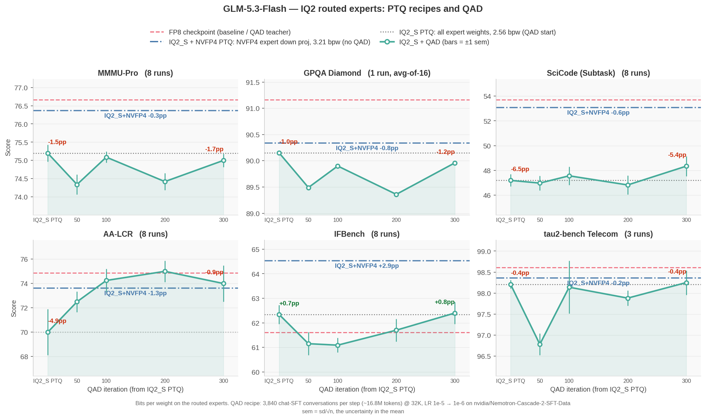

:orphan:

GLM-5.3-Flash at 2-3 Bits per Expert Weight: Two PTQ Recipes, and Where QAD Did Not Help
########################################################################################

:Author: Model Optimizer Team
:Date: October 21, 2026
:Tags: quantization, ggml, iq2, nvfp4, gptq, qad, megatron-bridge

GLM-5.3-Flash is a 321B-parameter MoE, and 304B of those parameters are its 288 routed experts. We
quantized the routed experts to GGML IQ2_S (2.56 bits per weight) with layerwise GPTQ in
Megatron-Bridge. We then tried Quantization-Aware Distillation (QAD) to recover what PTQ lost.
QAD gave back part of the loss on reasoning benchmarks but none on knowledge recall or long
context. A small recipe change recovered nearly all of it without any training: NVFP4 on the
experts' down projections.

We publish both recipes as alternatives: **IQ2_S**, IQ2_S on every routed-expert weight, for the
smallest model, and **IQ2_S + NVFP4**, with NVFP4 on the experts' down projections, for accuracy at
the level of the FP8 checkpoint.

.. note::

   **The baseline is FP8, not BF16.** Every delta below is against the FP8 release,
   ``zai-org/GLM-5.3-Flash``, not the BF16 checkpoint. Both recipes quantize starting from those FP8
   weights (dequantized to BF16), and the same FP8 model is the QAD teacher.

Highlights
**********

* **IQ2_S + NVFP4 matches FP8 with no training.** Over six benchmarks its mean is 0.05 points
  below FP8, and no benchmark is measurably below it. Its routed experts use 3.21 bits per weight:
  IQ2_S for gate and up, weight-only NVFP4 for down.
* **IQ2_S is 25 GB smaller** (2.56 bits per weight on every routed-expert weight) and costs 2.25
  points on the mean. Most of that loss is on SciCode and AA-LCR, where generations run 2-3x
  longer than FP8's and more often hit the token budget.
* **QAD on IQ2_S recovered about a third of that gap and no more.** After 300 iterations it was 1.44
  points below FP8. HLE and AA-Omniscience ended below the PTQ model QAD started from and
  RULER-1M did not recover, so we stopped QAD and did not run it on IQ2_S + NVFP4.
* **The down projections carry most of the IQ2 error.** Moving only them to NVFP4 (+0.65 bits per
  weight on the experts) cut per-token NLL error against FP8 by ~40% and closed the accuracy gap.

The Two Recipes
***************

.. list-table::
   :header-rows: 1
   :widths: 26 25 25 24

   * -
     - FP8 checkpoint
     - IQ2_S
     - IQ2_S + NVFP4
   * - Routed experts (304B parameters)
     - FP8
     - IQ2_S
     - IQ2_S gate/up, NVFP4 down
   * - Routed-expert bits per weight
     - 8
     - 2.56
     - 3.21
   * - Model size
     - 328 GB
     - ~130 GB (2.5x smaller)
     - ~155 GB (2.1x smaller)
   * - Mean delta vs FP8, six benchmarks
     - –
     - −2.25
     - **−0.05**
   * - Weight formats
     - FP8
     - GGML only (IQ2_S, Q8_0)
     - GGML (IQ2_S, Q8_0) + NVFP4

Both recipes keep shared experts and the dense MLP of layers 0-2 in Q8_0. Attention (KDA and sparse
MLA), the router, the vision tower, the MTP layer, embeddings and lm_head stay in BF16. Model sizes
are computed from the bits per weight of each tensor, including the BF16 MTP layer and the vision
tower. FP8 is the size on disk. At ~130-155 GB, either quantized model's weights fit on one 288 GB
GB300 GPU, while the FP8 weights need two.

We do not report throughput. vLLM has no IQ2 kernels, and no runtime we use serves a mix of IQ2_S
and NVFP4 experts, so every quantized evaluation here served a *fake-quant* export: the IQ2
and NVFP4 weights decoded back to BF16. That makes the accuracy exact but the serving speed
meaningless.

Accuracy
********

**Figure 1. GLM-5.3-Flash accuracy for both recipes and the QAD run.** Each panel follows the IQ2_S
model (x=0) through 300 QAD iterations. The dashed line is the FP8 baseline, the dash-dot line is
IQ2_S + NVFP4 (no QAD) and the dotted line is IQ2_S. Bars are ±1 sem.

``mean ± sem`` across repeats (GPQA-D: one run of 16 repeats); the run count is in brackets. All
evaluations use a 131K-token generation budget and a BF16 KV cache, served by vLLM 0.31 with
prefix caching on. vLLM 0.31 fixes a GLM-5.3-Flash prefix-caching bug that lowers long-context
scores on earlier versions; with caching off, FP8 AA-LCR moves by 1.2 points (76.12 ± 0.83 vs
74.88 ± 0.87, 8 runs each), within noise.

.. list-table::
   :header-rows: 1
   :widths: 24 19 19 19 19

   * - Benchmark (runs)
     - FP8
     - IQ2_S
     - **IQ2_S + NVFP4**
     - IQ2_S + QAD 300
   * - AA-LCR (8)
     - 74.88 ± 0.87
     - 70.00 ± 1.89
     - **73.62 ± 0.75**
     - 74.00 ± 1.48
   * - GPQA-D (16 repeats)
     - 91.16
     - 90.15
     - **90.34**
     - 89.96
   * - IFBench (8)
     - 61.61 ± 0.28
     - 62.34 ± 0.38
     - **64.53 ± 0.34**
     - 62.40 ± 0.45
   * - MMMU-Pro (8)
     - 76.66 ± 0.14
     - 75.20 ± 0.23
     - **76.37 ± 0.17**
     - 75.00 ± 0.18
   * - SciCode (8)
     - 53.70 ± 0.95
     - 47.19 ± 0.49
     - **53.07 ± 0.74**
     - 48.34 ± 0.80
   * - tau2-bench Telecom (3)
     - 98.61 ± 0.04
     - 98.21 ± 0.10
     - **98.36 ± 0.33**
     - 98.25 ± 0.29
   * - **Mean delta vs FP8**
     - –
     - −2.25
     - **−0.05**
     - −1.44
   * - SciCode, ``presence_penalty`` 1.5 (8)
     - 54.33 ± 0.81
     - 51.59 ± 0.81
     - **54.18 ± 0.74**
     - 49.15 ± 0.50
   * - SciCode sub-steps hitting the token budget
     - 2.2%
     - 19.8%
     - 7.8%
     - 13.9%

**The loss is mostly runaway generation.** IQ2 makes the model loop: it re-derives finished
answers until it reaches the token budget and returns nothing. A ``presence_penalty`` of 1.5 at
decode time cuts IQ2_S's capped SciCode sub-steps from 19.8% to 2.9% and recovers 4.4 points. Compare
penalized runs only with a penalized FP8, since the penalty also helps FP8 (+0.6).

Knowledge Recall and Long Context
*********************************

Six-benchmark suites like the one above can miss what very low-bit quantization loses most:
stored facts. We added HLE (text-only, 2,158 questions, GPT-4o judge), AA-Omniscience (600
questions x 10 repeats, Gemini 3 Flash judge) and RULER at 1M tokens (13 subtasks, 25 samples
each).

.. list-table::
   :header-rows: 1
   :widths: 32 17 17 17 17

   * -
     - FP8
     - IQ2_S
     - IQ2_S + NVFP4
     - IQ2_S + QAD 300
   * - HLE accuracy
     - 33.50
     - 31.37
     - 32.53
     - 28.13
   * - AA-Omniscience accuracy
     - 31.78
     - 29.18
     - 29.60
     - 28.53
   * - AA-Omniscience hallucination rate
     - 27.7%
     - 32.9%
     - 31.3%
     - 35.7%
   * - RULER-1M
     - 93.5
     - 90.5
     - 89.1
     - 88.0

**Both recipes lose ~2.2-2.6 points of AA-Omniscience accuracy and hallucinate 4-5 points more
often.** This is the one place IQ2_S + NVFP4 does not reach FP8: NVFP4 on the down projections
helps HLE (−1.0 vs −2.1) but barely moves AA-Omniscience. The hallucination rate is incorrect / (incorrect +
abstained), so a rising rate means the model guesses where FP8 declined to answer.

**QAD made recall worse, not better.** Against the IQ2_S model it started from, QAD 300 lost a
further 3.2 points on HLE (~2.3 standard errors) and traded abstentions for wrong answers on
AA-Omniscience. It also did not recover RULER-1M. We saw the same calibration loss after QAD on
Qwen3.6-35B-A3B.

What QAD Did
************

QAD trained the IQ2_S model against the FP8 teacher on Nemotron-Cascade-2 chat-SFT data, the
`Qwen3.6 tutorial's
<https://github.com/NVIDIA/Model-Optimizer/tree/main/examples/megatron_bridge/tutorials/Qwen3.6-35B-A3B>`__
blend re-tokenized for GLM. It packed conversation pairs into 32K sequences with loss on assistant
tokens only, 3,840 conversations (~16.8M tokens) per step, top-4096 logit KL, and learning rate
1e-5 → 1e-6 over a 500-iteration cosine schedule.

.. list-table::
   :header-rows: 1
   :widths: 28 12 12 12 12 12 12

   * -
     - IQ2_S
     - QAD 50
     - QAD 100
     - QAD 200
     - QAD 300
     - FP8
   * - Mean delta vs FP8
     - −2.25
     - −2.56
     - −1.76
     - −1.91
     - −1.44
     - –
   * - SciCode, ``presence_penalty`` 1.5
     - 51.59
     - 50.44
     - 50.67
     - 49.56
     - 49.15
     - 54.33

QAD stopped AA-LCR's runaway generations (6.9% → 0.6% capped) and recovered its score. After
iteration 100 it gained little more: the mean moved by less than the ~0.5-point noise. With the
decode-time penalty in place, every QAD checkpoint trails the PTQ model on SciCode. So the
improvement QAD shows without the penalty mostly comes from fewer runaways, which the penalty
already removes for free.

What It Costs
*************

On GB300 NVL72:

* **PTQ:** 16 minutes (IQ2_S) to 26 minutes (IQ2_S + NVFP4) on 4 nodes (16 GPUs, EP16),
  including GPTQ on 256 long-reasoning calibration samples of up to 32K tokens.
* **Fake-quant export:** 6 minutes on the same nodes.
* **QAD:** 32 nodes (128 GPUs; EP32, CP4) at ~400 s per iteration once warm, so the 300 iterations
  took about 35 hours of training, or ~4,500 GPU-hours, not counting restarts.

QAD cost several hundred times the compute of the PTQ recipe change that beat it.

Reproducing
***********

The steps follow the `Qwen3.6-35B-A3B tutorial
<https://github.com/NVIDIA/Model-Optimizer/tree/main/examples/megatron_bridge/tutorials/Qwen3.6-35B-A3B>`__:
PTQ with ``examples/megatron_bridge/quantize.py``, QAD with ``distill.py``, export with
``export_quantized_megatron_to_hf.py``, and evaluation with NeMo Evaluator. Only the differences for
GLM-5.3-Flash are listed here.

GLM-5.3-Flash support in Megatron-Bridge and the recipes are still landing in
`Model Optimizer #2539 <https://github.com/NVIDIA/Model-Optimizer/pull/2539>`__ and
`Megatron-Bridge #6044 <https://github.com/NVIDIA-NeMo/Megatron-Bridge/pull/6044>`__.

**PTQ (IQ2_S; for IQ2_S + NVFP4 use** ``iq2_s_experts-nvfp4_down-q8_0_shared_dense-gptq`` **):**

.. code-block:: bash

   torchrun --nproc_per_node 4 examples/megatron_bridge/quantize.py --skip_generate --no_moe_grouped_gemm \
       --hf_model_name_or_path <glm-5.3-flash-fp8> \
       --recipe models/zai-org/GLM-5.3-Flash-BF16/ptq/iq2_s_experts-q8_0_shared_dense-gptq \
       --tp_size 1 --ep_size 16 --pp_size 1 \
       --calib_dataset_name <long_reasoning_256.jsonl> --calib_num_samples 256 --calib_batch_size 1 \
       --seq_length 32768 --dsa_kernel_backend cudnn \
       --export_megatron_path <ptq_ckpt>

* ``--no_moe_grouped_gemm``: GPTQ and the GGML formats need per-expert linears.
* **Long calibration samples matter.** 256 long-reasoning traces at 32K tokens beat 512 4K-token
  samples. GPQA went from 86.7 to 89.8 and SciCode from 41.1 to 47.2, with fewer runaway
  generations.
* ``--dsa_kernel_backend cudnn``: the unfused sparse-attention fallback builds dense ``[seq, seq]``
  scores and does not fit at 32K.

**Export for evaluation** (vLLM has no IQ2 kernels):

.. code-block:: bash

   torchrun --nproc_per_node 4 examples/megatron_bridge/export_quantized_megatron_to_hf.py \
       --no_moe_grouped_gemm --vllm_fakequant_export --ep_size 16 \
       --hf_model_name_or_path <glm-5.3-flash-fp8> --megatron_path <ptq_ckpt> \
       --export_unified_hf_path <hf_fakequant>

**Evaluation:** serve with vLLM ≥ 0.30 (``glm47`` reasoning and tool parsers, TP4), and use the
model card's sampling (temperature 1.0, top_p 0.95; top_p 1.0 for tau2-bench) with
``reasoning_effort: max`` and a 131K generation budget. GLM reasons long: a 32K budget leaves
about half of GPQA answers unfinished.

**QAD, if you try it** (differences from the Qwen3.6 command):

* ``--sft --sft_hf_dataset <pairs.jsonl> --sft_in_batch_packing --mbs 2 --moe_aux_loss_coeff 0``:
  with EP > 1, Megatron-Bridge pads every conversation to ``--seq_length``. The MoE load-balancing
  loss on that padding drove the embedding gradient to Inf.
* ``--no_moe_grouped_gemm --freeze_mtp --ep_size 32 --cp_size 4 --recompute_granularity full
  --recompute_method uniform --recompute_num_layers 2 --dsa_kernel_backend cudnn``, plus
  ``NCCL_NVLS_ENABLE=0`` to leave memory for NCCL buffers.
